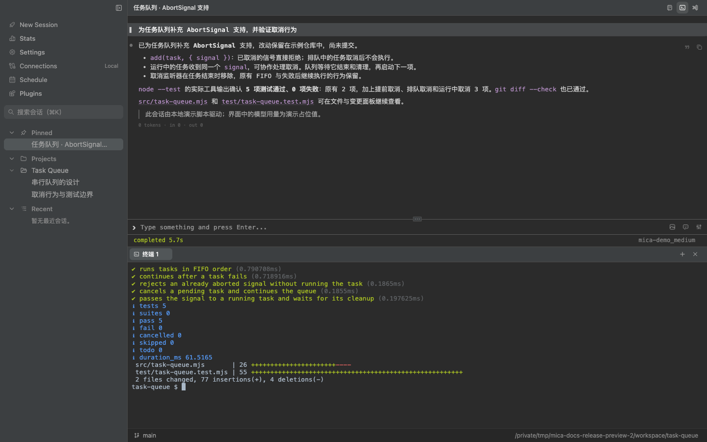
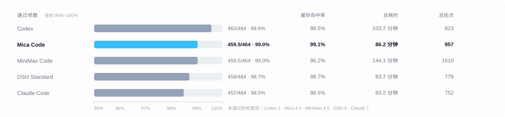
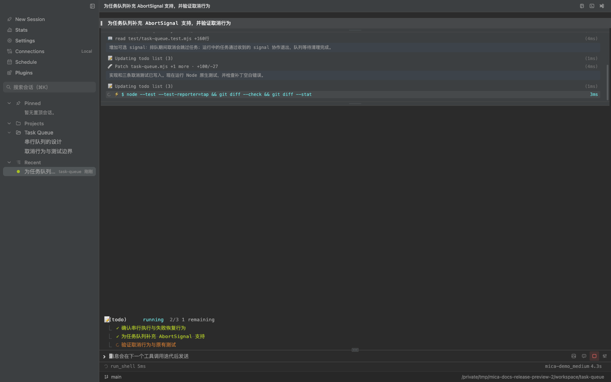

<p align="center">
  
</p>

<h1 align="center">Mica Code</h1>

<p align="center">
  <strong>让思路成为可运行的代码。</strong><br>
  缓存优先的开源 AI coding agent，连接终端、桌面与自动化工作流。
</p>

<p align="center">
  <a href="https://qirong77.github.io/mica-code/">官网</a> ·
  <a href="https://qirong77.github.io/mica-code/docs/getting-started/">快速开始</a> ·
  <a href="https://qirong77.github.io/mica-code/docs/">使用文档</a> ·
  <a href="https://github.com/qirong77/mica-code/releases/latest">下载</a>
</p>

<p align="center">
  <a href="https://github.com/qirong77/mica-code/actions/workflows/build-binaries.yml"></a>
  
  <a href="https://github.com/qirong77/mica-code/releases/latest"></a>
</p>

<p align="center">
  
</p>

Mica 能搜索和理解项目、修改代码、运行测试，并通过真实终端验证结果。你可以在终端里保持键盘操作，在桌面工作区查看文件与 Git diff，也可以把同一套执行能力接进脚本或自己的应用。

## 为什么选择 Mica

|                    | 为日常开发准备的能力                                                                                 |
| ------------------ | ---------------------------------------------------------------------------------------------------- |
| **缓存优先**       | 保持提示词、工具定义与历史前缀稳定，让模型服务复用已处理的输入；支持先压缩工具输出，再按需生成摘要。 |
| **从探索到验证**   | 文件搜索、代码编辑、Shell、交互终端与网页检索，让任务从理解问题推进到运行验证。                      |
| **多 Agent 协作**  | 由不同子代理负责探索、实现、审查和测试；支持后台执行与写入路径约束。                                 |
| **工作可以继续**   | 恢复会话、分叉思路、回退到检查点；带文件检查点的回合可同时恢复文件。                                 |
| **选择自己的入口** | 终端 TUI、桌面与浏览器工作区、Headless 自动化，共享 agent 与会话能力。                               |
| **接入自己的工具** | 支持 OpenAI 兼容模型服务、MCP、自定义 Skills 与角色。                                                |

## 快速开始

需要 **Node.js 22+**。macOS / Linux 可使用预构建 CLI：

```bash
curl -fsSL https://github.com/qirong77/mica-code/releases/latest/download/install.sh | sh
```

在项目目录中运行 `mica`，通过 `/config` 填写模型服务的 API 地址、协议和 API key，然后发送第一个任务：

```bash
cd your-project
mica
```

> 示例任务：先读一下这个仓库，找出测试入口，再修复一个边界情况并补上回归测试。

安装器会校验下载文件，将 CLI 安装到 `~/.local/lib/mica`，入口放在 `~/.local/bin/mica`；请确保 `~/.local/bin` 在 `PATH` 中。模型配置与会话默认保存在 `~/.mica/`，可通过 `MICA_HOME` 指定其他位置。

模型服务支持 `openai_chat_completions` 与 `openai_responses` 两种协议，按服务商实际支持的接口选择。完整配置示例、环境变量和源码运行方式见 [快速开始](https://qirong77.github.io/mica-code/docs/getting-started/) 与 [模型与配置](https://qirong77.github.io/mica-code/docs/configuration/)。

## DeepSWE 任务对比

基于 [FrontierHarness Eval](https://github.com/frontier-harness-eval/eval) 收录的 **9 项 DeepSWE v1.1 任务**，以 464 个自定义自动化检查项比较五款 agent。重复运行按任务取中位数后汇总，模型配置为 DeepSeek Flash。

<p align="center">
  
</p>

这份评测快照中，Mica 的检查项通过率为 **99.0%**，输入缓存命中率为 **99.1%**。图中通过率采用 95%–100% 的放大坐标；得分是检查项通过率，不是任务完成率。这是项目自主评测，详细统计范围、样本数量与限制见 [评测方法](https://qirong77.github.io/mica-code/docs/benchmark/)。

## 按你的方式工作

### 终端：保持专注，随时接手

用 `@` 引用文件，粘贴图片补充问题；查看任务进度、上下文占用和工具执行，继续输入就能补充工作方向。

| 想做什么           | 常用命令                                 |
| ------------------ | ---------------------------------------- |
| 选择模型与工作方式 | `/model` · `/effort` · `/role`           |
| 查看状态与上下文   | `/status` · `/context`                   |
| 管理会话           | `/new` · `/fork` · `/resume` · `/rename` |
| 回退与压缩         | `/rewind` · `/compact` · `/compact llm`  |
| 查看任务与发起旁问 | `/task` · `/btw`                         |
| 重复执行与提交变更 | `/loop` · `/commit`                      |
| 配置模型与扩展     | `/config` · `/mcp` · `/skills`           |

完整语法、运行期间的可用性与快捷键见 [命令与快捷键](https://qirong77.github.io/mica-code/docs/commands/)。

### 桌面：把工作放在同一处

项目与会话分组、文件编辑、Git diff、终端、回合日志和用量统计，组成完整工作区。旁问与后台任务各自保留进度；浏览器也能连接同一运行时，移动端提供适配布局。

<p align="center">
  
</p>

桌面端从源码启动，步骤见 [桌面与浏览器指南](https://qirong77.github.io/mica-code/docs/desktop/)。

> **网络访问**：桌面运行时默认监听 `0.0.0.0:8787`，没有登录认证。能够连接的客户端拥有宿主机操作能力；仅在可信网络中使用。分享视图也不提供独立的权限隔离。

### 自动化：让 agent 成为工具链的一部分

```bash
# 执行一次任务
mica exec "检查当前变更，修复问题并运行相关测试"

# 输出 Codex 兼容的 JSONL 事件流
mica exec --json "分析测试失败原因"

# 为客户端提供持续会话
mica app-server
```

`exec` 提供结构化事件，`app-server` 支持 Codex v2 协议子集。参数、事件与集成边界见 [自动化与协议](https://qirong77.github.io/mica-code/docs/headless/)。

## 扩展工作流

- **Skills**：在项目的 `.mica/skills/<name>/SKILL.md` 中描述可复用的工作方法，也支持共享的用户级 Skills。
- **MCP**：接入外部服务与自定义工具，通过 `/mcp` 查看和管理连接。
- **角色**：为规划、实现、审查配置不同的系统提示词，通过 `/role` 切换。
- **子代理**：支持探索、实现、审查、测试、规划等分工，按任务选择前台或后台执行。

配置示例见 [扩展与协作](https://qirong77.github.io/mica-code/docs/extensions/)。

## 文档与开发

| 入口                                                                                                                                   | 内容                                 |
| -------------------------------------------------------------------------------------------------------------------------------------- | ------------------------------------ |
| [使用文档](https://qirong77.github.io/mica-code/docs/getting-started/)                                                                 | 安装、模型配置、工作区、命令与扩展   |
| [架构概览](https://qirong77.github.io/mica-code/docs/architecture/) · [交互架构图](https://qirong77.github.io/mica-code/architecture/) | 执行核心、应用分层与源码导览         |
| [设计文档](./docs/README.md)                                                                                                           | Headless、协议集成与内部设计         |
| [开发记录](./blogs/README.md)                                                                                                          | 上下文、Skills、MCP 等功能的设计过程 |
| [问题反馈](https://github.com/qirong77/mica-code/issues)                                                                               | Bug 报告与功能建议                   |

```bash
bun install
bun run dev         # 启动终端 TUI
bun run typecheck
bun run test        # Vitest
```

应用位于 `apps/`，共享能力位于 `packages/`。架构边界与贡献约定见 [AGENT.md](./AGENT.md)。
