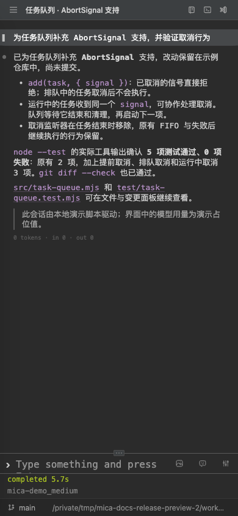

<p align="center">
  
</p>

<h1 align="center">Mica Code</h1>

<p align="center">
  <strong>从一个想法，到可运行的代码。</strong><br>
  开源、缓存优先的 AI 编程工作区。连接你的模型，把工作接着做完。
</p>

<p align="center">
  <a href="https://qirong77.github.io/mica-code/">官网</a> ·
  <a href="https://qirong77.github.io/mica-code/docs/getting-started/">快速开始</a> ·
  <a href="https://qirong77.github.io/mica-code/docs/">使用文档</a> ·
  <a href="https://github.com/qirong77/mica-code/releases/latest">CLI 下载</a>
</p>

<p align="center">
  <a href="https://github.com/qirong77/mica-code/actions/workflows/build-binaries.yml"></a>
  
  <a href="https://github.com/qirong77/mica-code/releases"></a>
</p>

<p align="center">
  
</p>
<p align="center"><sub>真实运行时 · 隔离示例项目 · 脚本化模型响应，图中用量为演示值。</sub></p>

Mica 是一个可以实际动手的 coding agent：搜索项目、编辑文件、运行测试、操作终端，再把过程和结果交给你审阅。你可以在终端里工作，在桌面或浏览器中打开完整工作区，也可以通过脚本驱动同一套执行能力。

它围绕长任务组织工作：稳定模型请求的上下文前缀，用压缩、笔记和记忆保留工作线索，用子代理和独立子会话分担任务。模型、工具与工作方法都可以按需选择。

## 开始使用

准备 **Node.js 22+** 和一个支持工具调用的模型服务。macOS / Linux 安装预构建 CLI：

```bash
curl -fsSL https://github.com/qirong77/mica-code/releases/latest/download/install.sh | sh
```

进入你的项目，启动 Mica：

```bash
cd your-project
mica
```

输入 `/config` 打开配置页，填写模型服务的 API 地址、协议和 API key，再用 `/model` 选择模型。配置页自动保存有效设置，然后就可以发送第一个任务：

> 阅读项目结构，找出测试入口。为一个边界情况补充测试，完成后运行验证，并说明改动与结果。

安装器校验 SHA-256，程序位于 `~/.local/lib/mica`，入口为 `~/.local/bin/mica`。如果找不到命令，将 `~/.local/bin` 加入 `PATH`。用户配置与会话默认存放在 `~/.mica`，可通过 `MICA_HOME` 隔离。

模型服务支持 `openai_chat_completions` 与 `openai_responses`，按服务实际提供的接口选择。更多示例见 [快速开始](https://qirong77.github.io/mica-code/docs/getting-started/) 和 [模型与配置](https://qirong77.github.io/mica-code/docs/configuration/)。Windows 与需要直接运行源码的开发者见下方的源码入口。

## 围绕真实任务构建

| 能力 | 在工作中怎么用 |
| --- | --- |
| **从理解到验证** | 搜索与引用文件、修改代码、运行 Shell 和交互式终端，让任务推进到可检查的结果。 |
| **缓存优先的上下文** | 保持指令、工具与历史前缀稳定；先在本地清理冗长工具输出，再按需用模型生成摘要。实际缓存由模型服务决定。 |
| **可继续的长任务** | 恢复历史、分叉方案、回退检查点。会话笔记保留任务决定，跨会话记忆保存长期偏好和项目经验。 |
| **多 agent 协作** | 用子代理分担探索、实现、审查和测试；用 Sidecar 启动可持续追问的独立子会话。 |
| **适合你的工作入口** | 终端 TUI、桌面与 Web 工作区、手机连接、Headless 自动化，共用模型、工具与会话能力。 |
| **按需组合能力** | 连接兼容模型服务和 MCP，用 Skills、角色与插件复用自己的工作方法。 |

[了解一次开发任务如何推进 →](https://qirong77.github.io/mica-code/docs/workflows/)

## 选择你的工作入口

### 终端：保持专注，随时接手

用 `@` 引用文件，粘贴图片补充问题。运行中继续输入可以补充要求，输入框为空时按 `Shift+←` 撤回待发消息，`Ctrl+C` 停止当前任务。

| 想做什么 | 命令 |
| --- | --- |
| 配置模型与工作方式 | `/config` · `/model` · `/effort` · `/role` |
| 查看状态与上下文 | `/status` · `/context` |
| 新建、分叉与恢复 | `/new` · `/fork` · `/resume` · `/rename` |
| 工作目录与会话整理 | `/cd` · `/clear` · `/exit` |
| 回退与压缩 | `/rewind` · `/compact` · `/compact llm` |
| 并行任务与临时追问 | `/task` · `/btw` |
| 能力与扩展 | `/capabilities` · `/mcp` · `/skills` |
| 计划与记忆 | `/todo` · `/memory` |
| 定时任务与提交 | `/loop` · `/commit` |
| 运行复盘 | `/harness-review list` · `/harness-review report` · `/harness-review assess` |

部分命令由官方插件提供，停用相应插件后不可用。完整参数、运行中的可用性和快捷键见 [命令与快捷键](https://qirong77.github.io/mica-code/docs/commands/)。

### 桌面与 Web：把过程放在眼前

项目分组和历史会话、代码编辑器、Git diff、工作区终端、回合日志与用量统计，在同一处查看。旁问与后台任务保留自己的进度，会话设置可以控制工具与插件。

<p align="center">
  
</p>

当前桌面与 Web 工作区从源码启动。在仓库根目录执行：

```bash
bun install
bun run build
cd apps/desktop
npm install
npm run dev
```

首次启动前先构建 CLI，因为桌面会调用已安装的 `mica`。独立浏览器工作区、运行产物与打包步骤见 [桌面与浏览器](https://qirong77.github.io/mica-code/docs/desktop/)。

### 手机与远程：换个屏幕，接着工作

同一网络中，通过 **Connections** 打开开发机地址并使用访问口令；跨网络时，可通过 **Mobile Relay** 插件部署或接入中转机，打开生成的手机链接。运行时保持在开发机上，手机可以查看进度、补充任务并操作工作区终端。

<details>
  <summary>查看同一任务的手机布局</summary>
  <p align="center">
    
  </p>
</details>

> 运行时默认监听 `0.0.0.0:8787`。完整远程访问使用口令，初始值 `0000` 应修改；分享链接也是访问凭据，可以调用运行时 API。只在本机使用时显式绑定 `127.0.0.1`。具体操作与能力范围见 [远程与手机访问](https://qirong77.github.io/mica-code/docs/remote-access/)。

### 自动化：把 agent 接进工具链

```bash
# 一次开发任务
mica exec "检查当前变更，修复问题并运行相关测试"

# 结构化事件流
mica exec --json "分析测试失败原因"

# 为客户端提供持续会话
mica app-server
```

`exec` 输出文本或 ThreadEvent JSONL；`app-server` 通过 stdin/stdout 提供 Codex v2 风格协议子集。执行能力使用宿主文件与命令环境，隔离需求由运行环境提供。参数、事件与集成方式见 [自动化与协议](https://qirong77.github.io/mica-code/docs/headless/)。

## 扩展你的工作方式

- **Skills 与项目指令**：将审查、发布等任务流程写入 `.mica/skills/<name>/SKILL.md`；把仓库通用约定放在 `AGENT.md` 或 `AGENTS.md`。
- **MCP 与角色**：接入外部服务和工具，选择适合规划、实现或审查的工作方式。
- **插件与会话能力**：在 Plugins 管理官方与用户插件，在会话设置中选择工具、Skills 和 MCP；部分插件配置支持按会话覆盖。
- **笔记与记忆**：笔记跟随当前会话；Memory 保存跨会话的用户偏好、环境经验与项目约定。自动整理会产生额外模型请求，可在插件设置中调整。
- **运行复盘**：Harness Review 本地记录工具失败、重复调用与重试，导出带证据的报告，并保留人工评估结论。

从 [插件与能力管理](https://qirong77.github.io/mica-code/docs/plugins/) 或 [Skills、MCP 与角色](https://qirong77.github.io/mica-code/docs/extensions/) 开始。

## 在具体任务中观察表现

基于 [FrontierHarness Eval](https://github.com/frontier-harness-eval/eval) 收录的 **9 项 DeepSWE v1.1 任务**，使用 464 个自定义自动化检查，对比五款 agent。模型配置为 DeepSeek Flash，重复运行按任务取中位数后汇总。

<p align="center">
  
</p>

该快照中，Mica 检查项通过率为 **99.0%**，输入缓存命中率为 **99.1%**。图表通过率轴从 95% 开始，检查项得分与任务完成率含义不同。这是项目自主评测，评分与效率样本分别聚合；统计范围与限制见 [评测方法](https://qirong77.github.io/mica-code/docs/benchmark/)，汇总数据见 [benchmark-data.json](./apps/website/public/benchmark-data.json)。

## 从源码运行与参与开发

准备 Git、Bun 与 Node.js 22+：

```bash
git clone https://github.com/qirong77/mica-code.git
cd mica-code
bun install
bun run dev
```

```bash
bun run typecheck
bun run test -- path/to/relevant.test.ts  # 根测试通过 Vitest 运行
bun run build                           # 构建并安装本机 CLI
```

macOS / Linux 支持发布安装器；Windows 请使用源码运行入口。应用在 `apps/`，共享能力在 `packages/`，官方插件在 `plugins/`。修改前阅读 [维护者手册](./AGENT.md)，行为变化与对应文档一起更新。

| 入口 | 内容 |
| --- | --- |
| [使用文档](https://qirong77.github.io/mica-code/docs/) | 按安装、日常工作、扩展和集成组织的指南 |
| [架构概览](https://qirong77.github.io/mica-code/docs/architecture/) · [交互架构图](https://qirong77.github.io/mica-code/architecture/) | 执行链路、应用边界与源码导航 |
| [设计文档](./docs/README.md) · [共享包索引](./packages/README.md) | 协议、运行时与包的公开入口 |
| [开发记录](./blogs/README.md) | 设计取舍与实现过程 |
| [演示素材复现](./docs/demo-assets.md) | 生成 README 与官网截图的方法 |
| [问题反馈](https://github.com/qirong77/mica-code/issues) | Bug 报告、使用问题与改进建议 |
